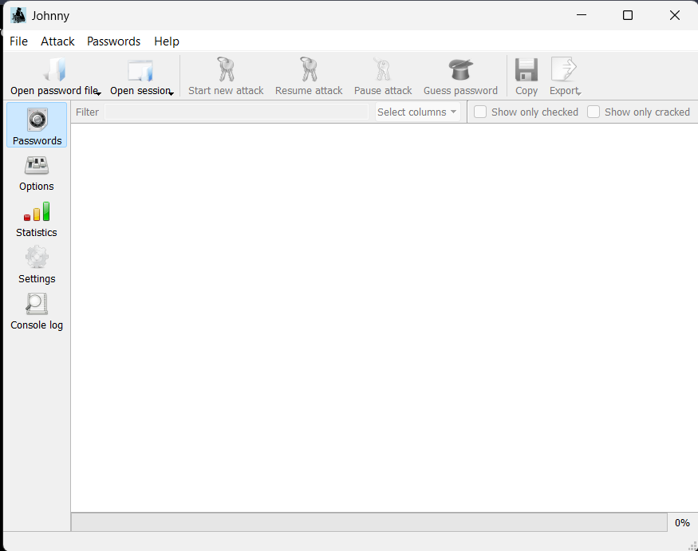
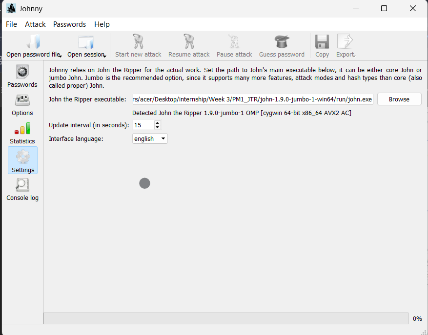
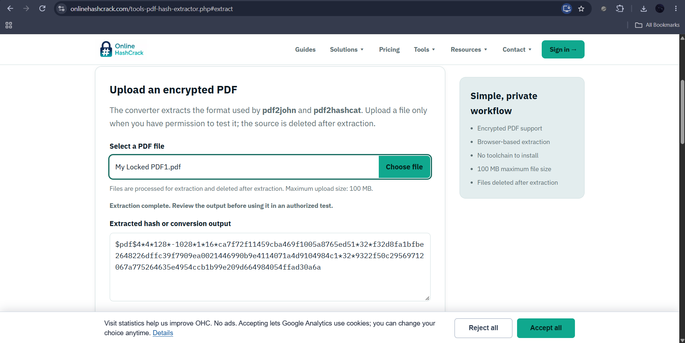
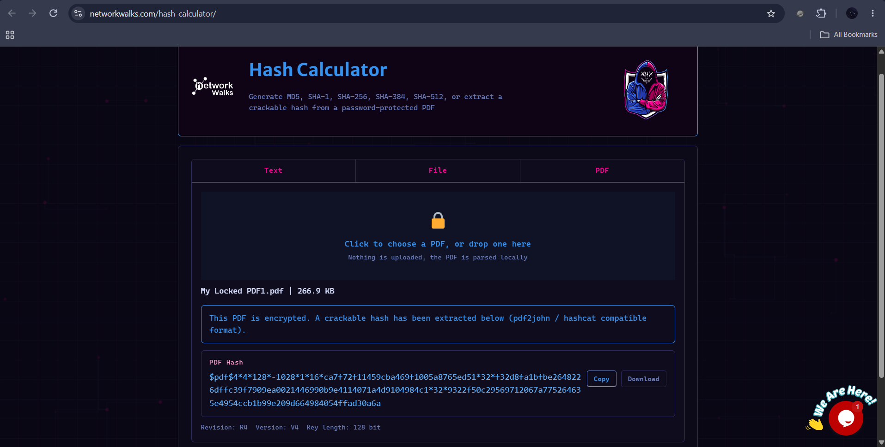
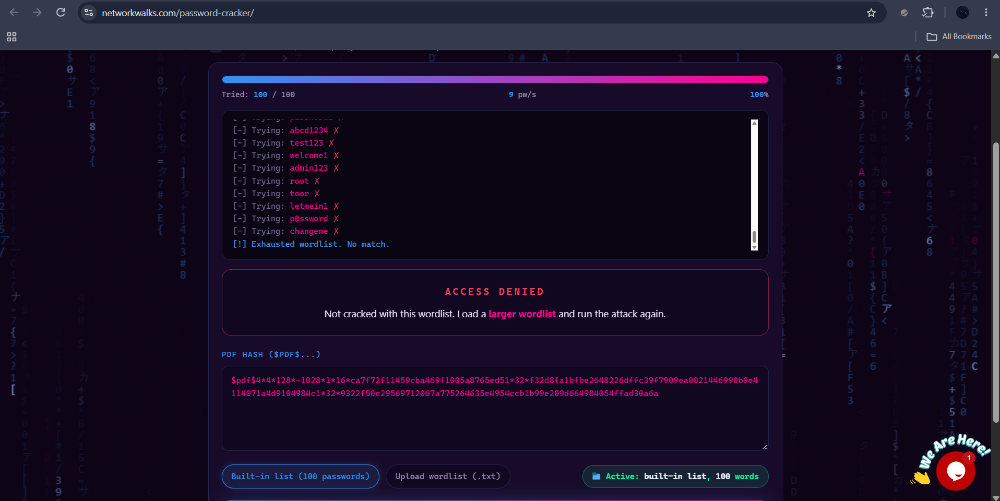
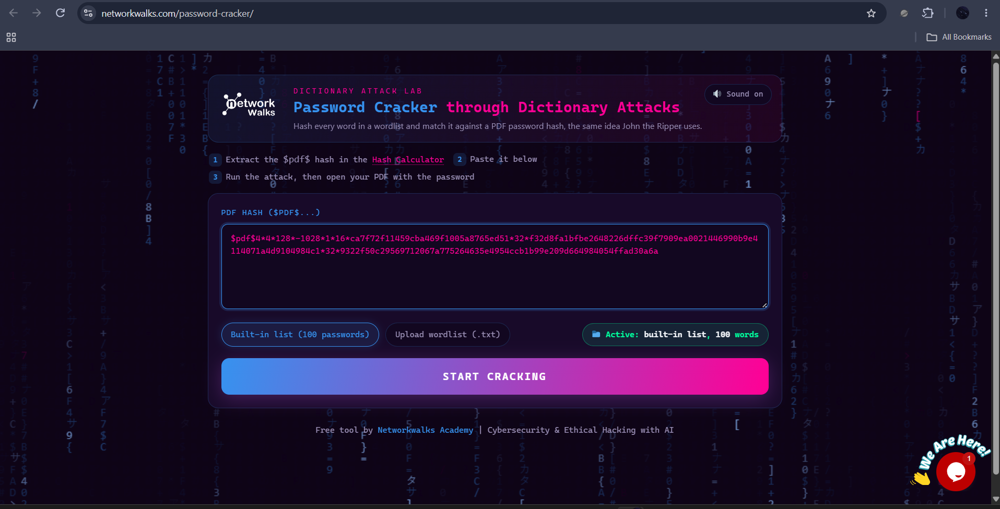
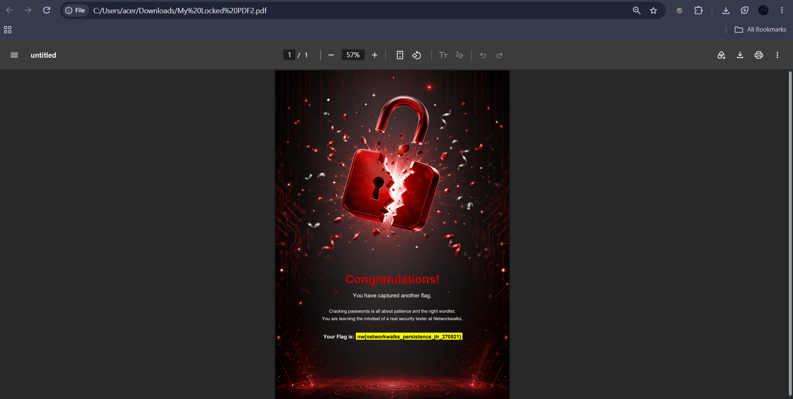

# Networkwalks Cybersecurity Internship – Week 3

## Overview

This repository contains my Week 3 internship practicals completed as part of the Networkwalks Cybersecurity Internship. This week, I worked on password security and password auditing using different tools.

---

## PM1 – Password Auditing with John the Ripper

The first practical was based on using John the Ripper and its graphical interface, Johnny, to understand password auditing.

### 1. Opening Johnny

Opened Johnny GUI to begin the practical.

### 2. Configuring John the Ripper

Configured the tool and checked that John the Ripper was detected correctly.

### 3. Practical Process

Worked through the password-auditing lab and documented the process and results.

### 4. Lab Result

The practical included different outcomes during the testing process, which helped me understand the auditing process better.

*Screenshots of password results are kept private or redacted before public sharing.*

---

## PM2 – Password Auditing with Networkwalks Tools

The second practical involved exploring the Networkwalks Hash Calculator and Password Cracker.

### 1. Hash Extraction

Explored the Hash Calculator as part of the password auditing exercise.

### 2. First Attempt

The first attempt returned an Access Denied result.

### 3. Loading the Lab Data

Explored the process of loading the lab data into the tool.

### 4. Audit Result

A subsequent attempt produced a successful result during the lab exercise.

*Sensitive result details are not included in this public documentation.*

### 5. Final Verification

Verified the outcome by opening the provided PDF in the lab environment.

---

## Tools Used

- John the Ripper
- Johnny GUI
- Networkwalks Hash Calculator
- Networkwalks Password Cracker

## What I Learned

- Basics of password hashes and password security.
- How password auditing works.
- Tool setup and configuration.
- Different outcomes during password-auditing exercises.
- The importance of strong passwords.

## Reports

- PM1 Report – John the Ripper
- PM2 Report – Networkwalks Tools

## Disclaimer

All activities were performed as part of assigned cybersecurity internship lab exercises for educational purposes.

**Status:** Week 3 – PM1 and PM2 completed.
